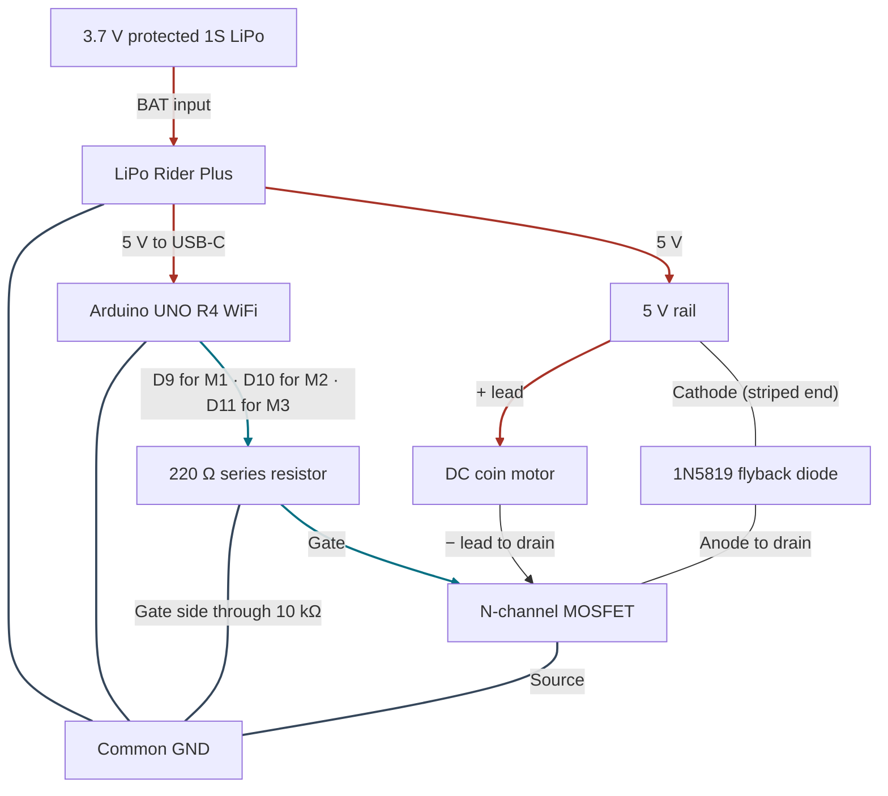

# haptell-04 Triple DC Motor Wiring

Build the motor driver shown below three times. Connect M1 to D9, M2 to D10,
and M3 to D11. All three channels share the 5 V and ground rails.

Add one 10k pulldown from each MOSFET gate to GND. Add one 1N5819 diode across
each motor with the cathode on the 5 V side and the anode on the MOSFET drain
side.
