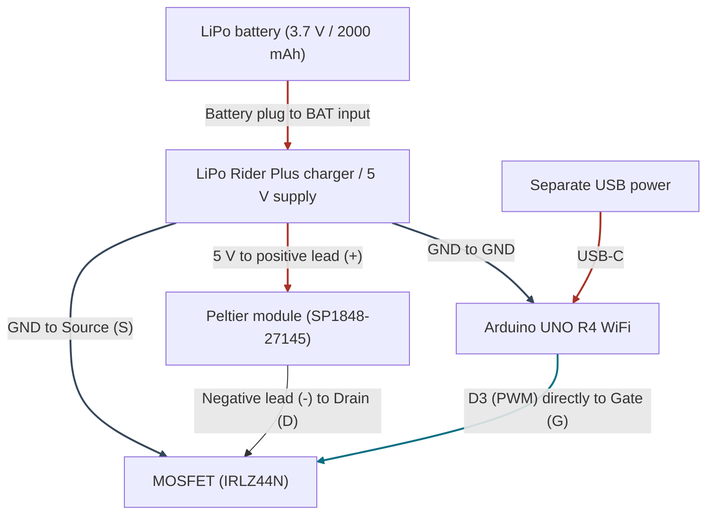

# Haptell-06 connection diagram

Each box is one physical component. Read each connection label from the
starting box to the destination box.

Arduino has a separate power supply. Arduino GND, LiPo Rider Plus GND and the
MOSFET source share a common ground.
The Peltier module's hot side contacts the heatsink through a thermal interface.
See [hardware notes](README.md) for the component list and wiring details.
