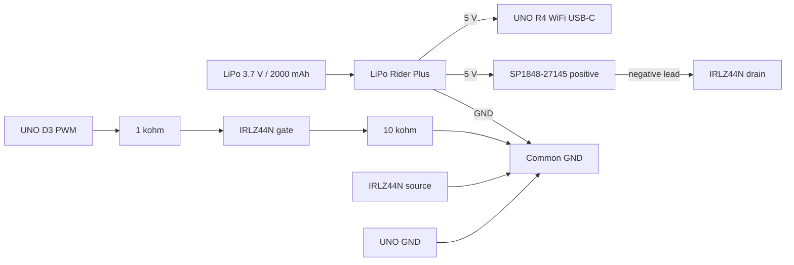

# Haptell-06 connection diagram

Editable wiring source for the single-polarity, low-side IRLZ44N prototype.

```text
3.7 V / 2000 mAh LiPo -> LiPo Rider Plus BAT

Rider Plus 5 V ----+----> Arduino UNO R4 WiFi USB-C power
                  |
                  +----> SP1848-27145 (+)
                         SP1848-27145 (-) ----> IRLZ44N drain

Arduino D3 PWM -- 1k resistor --> IRLZ44N gate
                                      |
                                     10k
                                      |
Rider Plus GND ----+-------------------+------> IRLZ44N source
                  +----> Arduino GND

SP1848-27145 hot side -> thermal interface -> heatsink
```



This is a connection diagram, not a PCB layout. Drain, gate and source are
terminals of the same MOSFET. See [hardware notes](README.md) for load-current
and thermal requirements. Temperature sensing is reserved for a later version.
