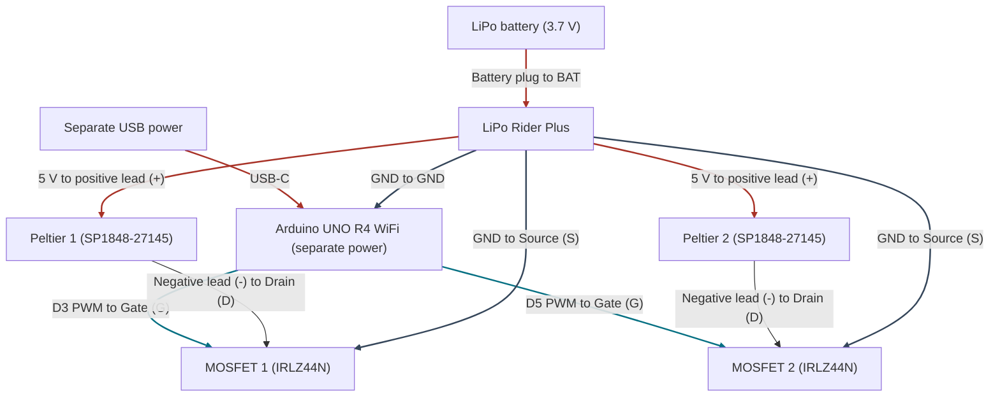

# Haptell-07 dual Peltier connection diagram

Draft derived from Haptell-06. Each box represents one physical component.
The Arduino has a separate power supply.

Both MOSFET sources and Arduino GND connect to Rider Plus GND. The draft
copies the direct gate wiring and component models from Haptell-06 for both
channels. D3 and D5 are independent PWM outputs on the [UNO R4 WiFi](https://docs.arduino.cc/tutorials/uno-r4-wifi/cheat-sheet/#pwm).

The shared 5 V rail is a design assumption. The [Rider Plus](https://wiki.seeedstudio.com/Lipo-Rider-Plus/)
is rated for up to 2.4 A at 5 V. Measure the combined on-state current with
both Peltier modules driven before confirming the shared supply.
